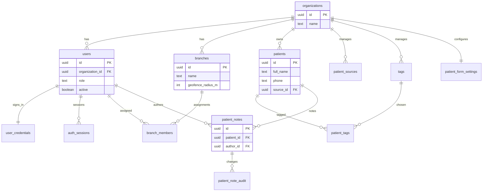
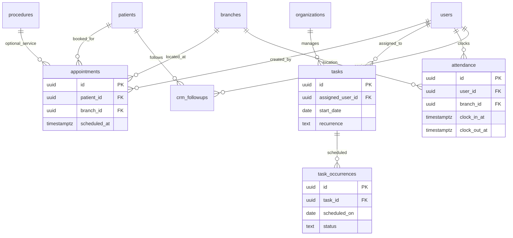
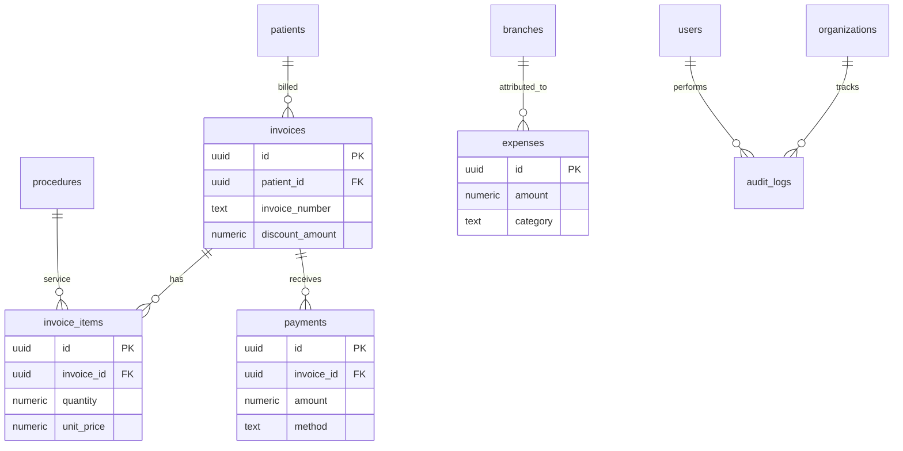

# ClinicFlow — تصفح تصميم قاعدة البيانات

> **مهم:** ده رسم لتصميم PostgreSQL المقترح على فرع التطوير، **مش قاعدة بيانات شغالة، ومش نسخة من Floot**. ما فيش بيانات مرضى حقيقية في الملف ده. المشروع ما زال محتاج فحص قاعدة Floot الفعلية قبل أي Migration.

## 1. المستخدمين، الفروع والمرضى

## 2. المواعيد، المهام والحضور

## 3. الفواتير والمدفوعات والمصاريف

## الملفات والاختبارات

- [ملف إنشاء الجداول، العلاقات والقيود — 001_foundation.sql](../migrations/001_foundation.sql)
- [قيم مصادر المرضى والتاجز — 002_initial_options.sql](../migrations/002_initial_options.sql)
- [البرومبت الأحدث وقواعد التوافق مع Floot](./DEVELOPMENT_TARGET_2026-10-17.md)
- [فحص Schema الأصلي بأسئلة SQL للقراءة فقط](./FLOOT_SCHEMA_INSPECTION_READONLY.sql)
- [تسجيل الدخول — كود Backend مقترح](../api/auth/login.js)
- [جلسات المستخدمين](../api/auth/session.js)
- [اختبارات Postgres المؤقتة](../tests/auth.test.mjs)

### الخطوة المطلوبة لتحويل التصميم إلى Database حقيقية

نحتاج أولًا نفحص الجداول والعلاقات الموجودة فعلًا في **Floot PostgreSQL**، وبعدها نحدد إذا هنكمل قاعدة Floot نفسها أو نجهز Database مستقلة وننفذ نقل بيانات مُراجع وآمن. القاعدة الموجودة على GitHub هي **كود للتصميم**؛ GitHub مش بيشغل PostgreSQL.

> **تنبيه:** الرسم الحالي يوضح أول Schema تجريبي، وفيه ربط إلزامي للمهام والفواتير بفرع، بينما البرومبت الأحدث يطلب نظام بيانات موحدًا للعيادتين. **لا تطبّق SQL المقترح على قاعدة Floot** قبل تصحيح الفروق وفحص المخطط الأصلي.
